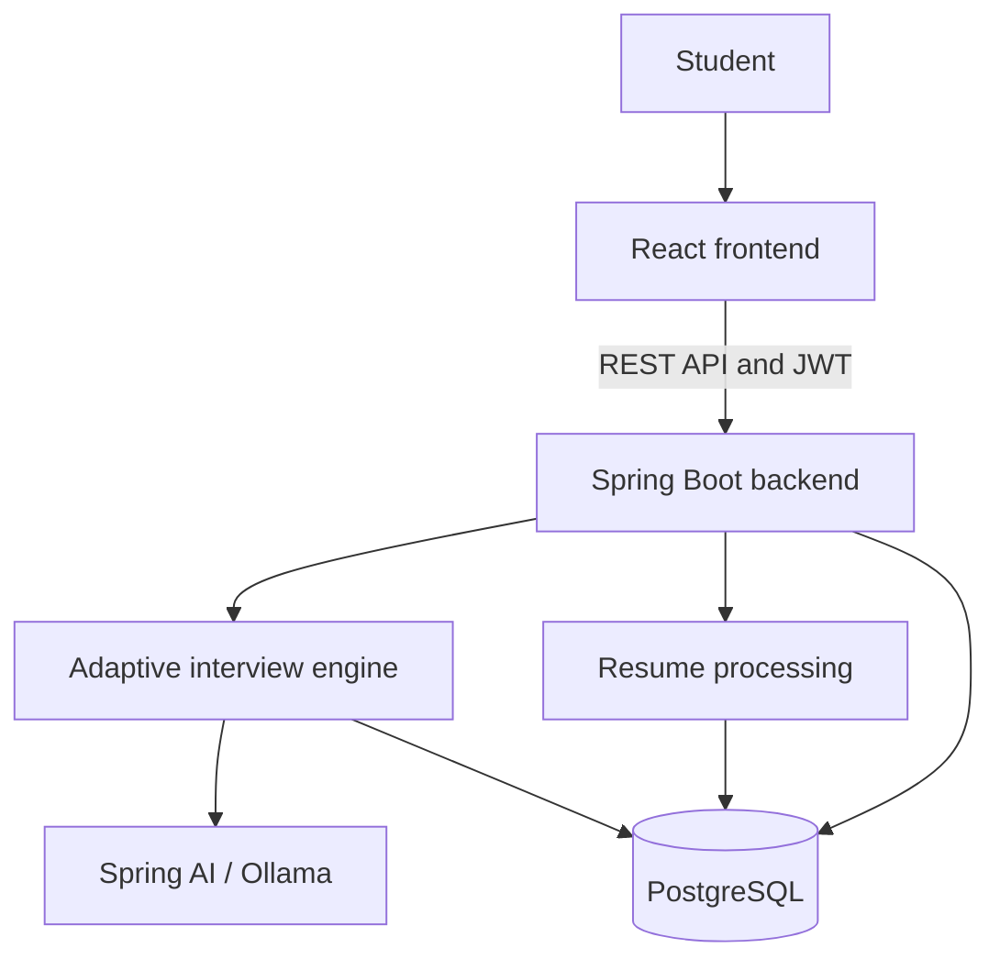

# PlacementAI — Adaptive AI Interview Platform

PlacementAI is an AI-powered campus placement preparation platform that simulates company-specific interviews, evaluates candidate responses and provides personalized feedback. It helps students identify knowledge gaps, practice technical and HR interviews, and track their preparation progress.

**Current version: V3.5 — Core Refinement**

## Features

- Company-specific campus placement simulations and technical practice.
- Adaptive question selection based on difficulty, topic and candidate performance.
- AI-assisted answer evaluation using Ollama and Spring AI, with expected-answer criteria.
- PDF resume parsing, persistent resume analysis and skill-based questions.
- Interview timer, progress tracking, skip questions, tab-local answer drafts and resumable sessions.
- Detailed reports with topic-wise scores, strengths, weaknesses, recommendations and individual answer feedback.
- Interview history with search and status filters; printable reports with browser Save as PDF.
- Responsive dashboard with company branding, search and preparation statistics.
- JWT authentication, session ownership checks and PostgreSQL persistence.

## Supported hiring profiles

| Company | Profiles |
| --- | --- |
| TCS | Ninja, Digital, Prime |
| HCLTech | GET |
| Infosys | System Engineer |
| Cognizant | GenC |
| Connecticus | Company-specific practice |
| AlgoQuant | Company-specific practice |

The question bank contains 610 company-profile records and 81 distinct question texts, including shared fundamentals. Questions are curated practice material and public-report-inspired adaptations, not verified official recruitment questions or hiring predictions.

## Technology stack

| Layer | Technology |
| --- | --- |
| Frontend | React, Vite, JavaScript, CSS, Axios |
| Backend | Java 21, Spring Boot, Spring Security, Spring Data JPA |
| AI | Spring AI, Ollama, Llama 3.2 |
| Database | PostgreSQL |
| Resume processing | Apache PDFBox |
| Authentication | JWT |
| Build and deployment | Maven, npm, Docker Compose, Vercel configuration |

## Architecture



The backend manages authentication, question selection, interview sessions and reports. Ollama evaluates answers against expected criteria. The adaptive engine selects subsequent questions based on performance and interview stage. Current follow-ups are selected from the question bank; fully generative contextual follow-ups are planned.

## Getting started

### Prerequisites

- JDK 21 and Maven 3.9+
- Node.js 22 and npm
- PostgreSQL
- Ollama
- Python 3 (optional, for dataset validation)

### 1. Clone the repository

```bash
git clone https://github.com/MNIAJ/adaptive-ai-interview-platform.git
cd adaptive-ai-interview-platform
```

### 2. Configure PostgreSQL

Create a database named `interview_platform` if it does not already exist. Keep your PostgreSQL username and password available. Back up existing data before applying upgrades.

### 3. Prepare the AI model

```bash
ollama pull llama3.2
```

Ensure Ollama is running on `http://localhost:11434`. If it is not already running, use `ollama serve` in a separate terminal.

### 4. Start the backend (Windows PowerShell)

```powershell
cd backend
powershell -ExecutionPolicy Bypass -File .\start.ps1
```

Enter your PostgreSQL password when prompted. The script maintains a local JWT secret across restarts. The backend runs on `http://localhost:8080` by default.

### 5. Start the frontend

In another terminal, from the repository root:

```bash
cd frontend
npm install
npm run dev
```

Open `http://localhost:5173`, register or log in, and select a company profile to begin practicing.

## Environment configuration

| Variable | Purpose |
| --- | --- |
| `DB_URL` | PostgreSQL JDBC connection URL |
| `DB_USER` | Database username |
| `DB_PASSWORD` | Database password |
| `JWT_SECRET` | Persistent random signing secret |
| `AI_PROVIDER` | Set to `springai` for real AI evaluation |
| `OLLAMA_URL` | Ollama inference endpoint |
| `OLLAMA_MODEL` | Model name, e.g. `llama3.2` |
| `FRONTEND_URL` | Allowed frontend origin |
| `VITE_API_URL` | Frontend API base URL, including `/api` |

Use `.env.example` as a configuration reference. Never commit `.env`, database credentials or `backend/.jwt-secret.local`.

## Project structure

```text
adaptive-ai-interview-platform/
├── backend/
│   ├── src/main/java/com/aiplacement/interview/
│   │   ├── ai/
│   │   ├── config/
│   │   ├── controller/
│   │   ├── dto/
│   │   ├── engine/
│   │   ├── entity/
│   │   └── service/
│   ├── src/main/resources/seed-data/
│   ├── pom.xml
│   └── start.ps1
├── frontend/
│   ├── src/api/
│   ├── src/components/
│   ├── src/pages/
│   └── package.json
├── compose.yaml
├── validate_dataset.py
├── .env.example
├── .gitignore
└── README.md
```

## Interview workflow

1. Register or log in.
2. Optionally upload a PDF resume for skill extraction.
3. Select a company, interview mode and difficulty.
4. Answer questions or skip unfamiliar questions.
5. Receive AI-assisted evaluation and adaptive subsequent questions.
6. Complete the session or resume an unfinished session from History.
7. Review the performance report and recommended preparation areas.

Resume analysis is stored against the account; original PDF bytes are not retained. Answer drafts are tab-local. Skipped questions receive zero marks. Older sessions without a stored current question may not support resumption.

## Question dataset

The question bank is maintained in `backend/src/main/resources/seed-data/campus_questions.psv`. It contains company profiles, topics, interview stages, difficulty levels, questions and evaluation criteria. Retired questions are preserved for historical interview records.

Validate the dataset from the repository root:

```bash
python validate_dataset.py
```

## Testing

Run the backend and frontend checks before deployment:

```bash
cd backend
mvn clean test
```

```bash
cd frontend
npm install
npm run build
```

Verify login after restart, resume persistence, all interview modes, question progression, skip and resume behavior, cross-account authorization, AI failure recovery and report accuracy. Full integration and production deployment testing remain to be completed.

## Deployment

Docker Compose and frontend deployment configuration are provided. Configure persistent PostgreSQL storage, a stable JWT secret, a reachable private Ollama endpoint and HTTPS. Set `FRONTEND_URL` to the deployed frontend origin and `VITE_API_URL` to the deployed backend HTTPS URL ending in `/api`. The frontend build output is `dist`.

Do not expose an unauthenticated Ollama endpoint to the public internet. Cloud deployment has not yet been verified.

## Roadmap

- Expand the bank to 500+ genuinely distinct questions.
- Generate contextual AI follow-ups based on candidate answers.
- Improve resume project analysis and company preparation pages.
- Integrate voice interviews with speech recognition and text-to-speech.
- Add a live coding arena with Monaco Editor and sandboxed execution.
- Complete production deployment and end-to-end testing.

## Project objective

This academic project explores how adaptive questioning, resume analysis and large language models can improve personalized campus placement preparation. Mock interview scores are intended as learning feedback, not predictions of actual recruitment outcomes.
